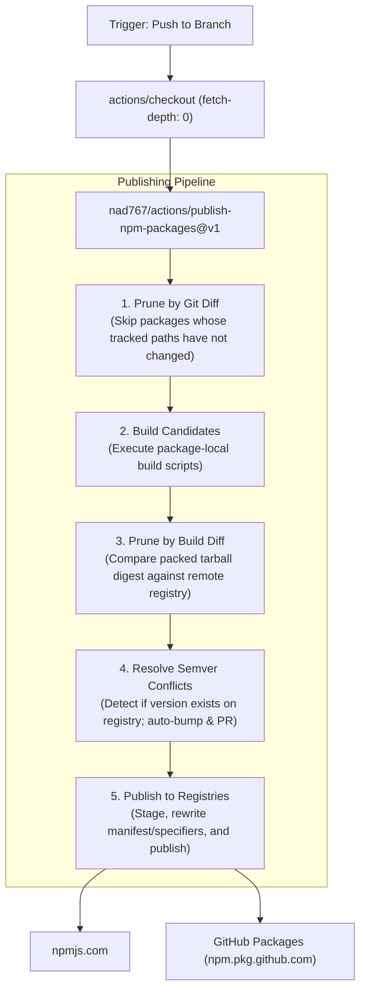

# Publish NPM Packages Action

A powerful, production-grade composite GitHub Action to build, prune, resolve version conflicts, and publish NPM packages to `registry.npmjs.org` and/or GitHub Packages (`npm.pkg.github.com`).

Works seamlessly with both **standalone single-package repositories** and **multi-package monorepos**.

## Features & Architecture



### 1. Incremental Publishing

- **Prune by Git Diff**: Compares local commits against the `gitHead` recorded in published package metadata. Unmodified packages are skipped before dependency installation or building.
- **Prune by Build Diff**: Packs the build output and compares file contents against the highest published release. If the output is byte-identical, publication is skipped to avoid redundant releases.

### 2. Automated Version Conflict Resolution & Pull Requests

If a package version is already published on the target registry:

- Automatically bumps the package version according to policy (`patch`, `minor`, `major`).
- Automatically updates `package.json` and `package-lock.json`.
- Opens a pull request via `peter-evans/create-pull-request` with release notes and automatically merges it when `merge_pr: 'true'`.

### 3. Registry Flexibility & Name Rewriting

Publish to public `npmjs`, private GitHub Packages (`ghp`), or both concurrently. Packages can maintain internal scopes locally while automatically renaming or re-scoping during publish.

### 4. Staged Publishing to npmjs (Onsite Approval / 2FA)

By default, packages targeting `npmjs` are staged via `npm stage publish` (`stage_to_npmjs: 'true'`), deferring proof-of-presence (2FA) and publication to an onsite review step on [npmjs.com](https://www.npmjs.com) (under the "Staged Packages" tab) or via CLI with `npm stage approve <stage-id>`.

To release without an approval step, set `stage_to_npmjs: 'false'` (or `"stageToNpmjs": false` per package in `targets_json`).

## Inputs

| Input | Description | Default | Required |
| :--- | :--- | :--- | :--- |
| `targets_json` | JSON array describing publishable packages and package-specific settings. | - | **Yes** |
| `registry` | Default registry for targets that omit `registry`. Values: `ghp`, `npmjs`, or `ghp, npmjs`. | `ghp` | No |
| `npmjs_token` | Auth token for `registry.npmjs.org`. Required when any package targets `npmjs`. | - | Conditional |
| `ghp_scope` | Scope for GitHub Packages (with or without `@`). Defaults to repository owner. | `<repo-owner>` | No |
| `tag` | npm dist-tag to publish under (e.g., `latest`, `beta`, `next`). | `latest` | No |
| `stage_to_npmjs` | Stage packages to npmjs via `npm stage publish` for onsite approval instead of direct full publish. | `'true'` | No |
| `version_conflict_policy` | How to handle published versions >= workspace version (`patch`, `minor`, `major`, `fail`). | `patch` | No |
| `merge_pr` | Whether to auto-merge the generated version-bump pull request before publishing. | `'true'` | No |
| `disable_prune_by_git_diff` | Skip the prune-by-git-diff check. | `'false'` | No |
| `disable_prune_by_build_diff` | Skip the prune-by-build-diff check. | `'false'` | No |
| `node_version` | Node.js version used for execution. | `'26'` | No |
| `npmrc_secrets` | Optional newline-delimited `KEY=VALUE` pairs exposed to `.npmrc`. | - | No |

## `targets_json` Schema

Each entry in `targets_json` is an object with the following fields:

```typescript
interface PublishTarget {
  /** Relative directory path to the package containing package.json (e.g., "." or "packages/core") */
  path: string;

  /** Optional npm run script to execute before publishing (e.g. "build") */
  buildScript?: string;

  /** Relative directory where built files are emitted. Required if buildScript is set (e.g. "dist") */
  buildOutDir?: string;

  /** Target registry name or comma-separated list: "npmjs", "ghp", or "ghp, npmjs" */
  registry?: string;

  /** Override scope when publishing to GitHub Packages (e.g., "my-org") */
  ghpScope?: string;

  /** Override full package name when publishing to GitHub Packages */
  ghpName?: string;

  /** Override scope when publishing to npmjs (e.g., "my-org") */
  npmjsScope?: string;

  /** Override full package name when publishing to npmjs (e.g., "@my-org/custom-name") */
  npmjsName?: string;

  /** Stage this package to npmjs using `npm stage publish` for onsite approval */
  stageToNpmjs?: boolean;
}
```

## Usage Examples

### 1. Standalone Package (Publishing to npmjs)

For standard repositories where `package.json` resides at the repository root:

```yaml
name: Release

on:
  push:
    branches: [main]

permissions:
  contents: write
  pull-requests: write
  id-token: write

jobs:
  publish:
    runs-on: ubuntu-latest
    steps:
      - uses: actions/checkout@v7
        with:
          fetch-depth: 0

      - uses: nad767/actions/publish-npm-packages@v1
        with:
          registry: npmjs
          npmjs_token: ${{ secrets.NPMJS_TOKEN }}
          targets_json: |
            [
              {
                "path": "."
              }
            ]
```

### 2. Standalone Package with Build Step (TypeScript / Bundler)

If your package has a build step (e.g., `npm run build` outputting to `dist/`):

```yaml
      - uses: nad767/actions/publish-npm-packages@v1
        with:
          registry: npmjs
          npmjs_token: ${{ secrets.NPMJS_TOKEN }}
          targets_json: |
            [
              {
                "path": ".",
                "buildScript": "build",
                "buildOutDir": "dist"
              }
            ]
```

### 3. Monorepo (Publishing to Both npmjs and GitHub Packages)

For npm workspaces or monorepos where multiple packages are published together in topological order:

```yaml
      - uses: nad767/actions/publish-npm-packages@v1
        with:
          registry: 'ghp, npmjs'
          npmjs_token: ${{ secrets.NPMJS_TOKEN }}
          ghp_scope: ${{ github.repository_owner }}
          version_conflict_policy: patch
          merge_pr: 'true'
          targets_json: |
            [
              {
                "path": "packages/core",
                "buildScript": "build",
                "buildOutDir": "dist"
              },
              {
                "path": "packages/ui",
                "buildScript": "build",
                "buildOutDir": "dist"
              }
            ]
```

## Required Permissions & Settings

### GitHub Workflow Permissions

In your workflow file:

```yaml
permissions:
  contents: write        # Required to update package versions and merge PRs
  pull-requests: write   # Required to open/merge version-bump PRs
  packages: write        # Required if publishing to GitHub Packages (ghp)
```

### GitHub Repository Settings

To allow the action to automatically merge version-bump pull requests:

1. Go to repository **Settings** &rarr; **Actions** &rarr; **General**.
2. Under **Workflow permissions**, enable:
   - **Read and write permissions**
   - **Allow GitHub Actions to create and approve pull requests**
3. Create an **Automation** token on [npmjs.com](https://www.npmjs.com) and add it as a repository secret named `NPMJS_TOKEN`.
